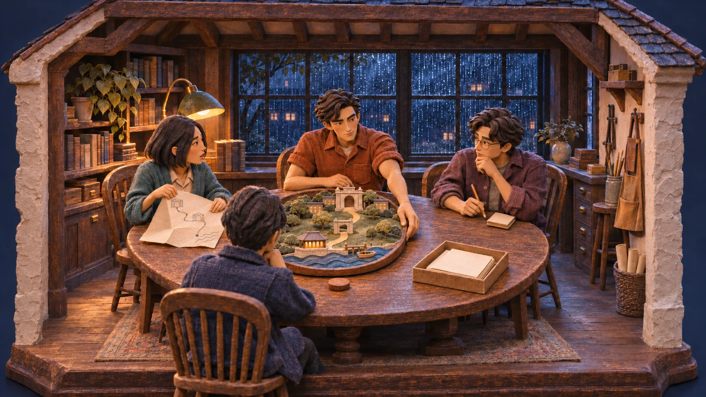
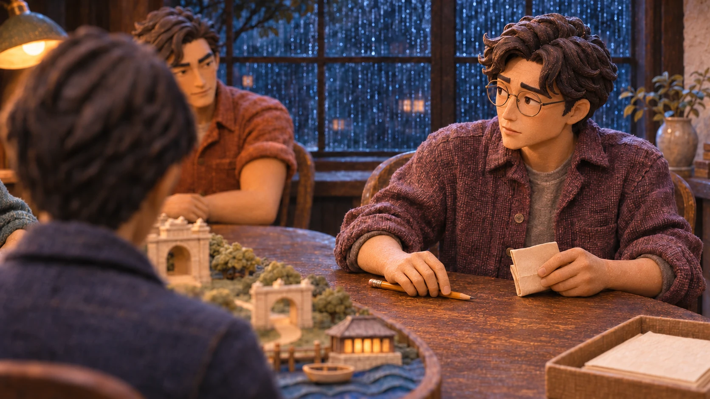

# Quiet Minute: sculpted dollhouse candidates

Two new cinematic stills explore the approved sculpted miniature direction as a deep, inhabited dollhouse world. They are review candidates; this folder does not change the player, story, hot spots, or default art.

## 01: The room

The camera steps back far enough to reveal the thick plaster walls, timber structure, floor, rainy window recesses, and the weight of the table and chairs. Nia, Theo, Ellis, and back-facing Ren remain around the same route model. The warm practical light is held inside the blue rainy night.

## 02: The person

The camera enters the same room and sits with Ellis. A lowered pencil on bare timber and a compact twice-folded packet make the withheld route physical. A targeted continuity correction removed the open map in front of Ellis in both shots; Nia's open shared route remains in the establishing shot. Ren remains an unresolved back-facing foreground presence; Theo is softly visible behind.

## Files

Each shot has an original 1672 × 941 RGB PNG and a same-size WebP for lightweight review. The WebPs are technical format derivatives, not a different generation. The initial generation sources remain unchanged outside this folder; the published pair includes the targeted folded-route correction.

- `01-quiet-minute-dollhouse-establishing.png` and `.webp`
- `02-quiet-minute-dollhouse-ellis-close.png` and `.webp`
- [Generation prompts](PROMPTS.md)
- [Provenance and review limits](PROVENANCE.md)

## Integration notes

- Start wide, then enter eye-level coverage. Do not hold the wide dollhouse shot for an entire dialogue scene; faces become too small on phones.
- Preserve the film-first scene and one consequential choice. This visual study is not a dashboard, new choice, or extra inspection gate.
- These are raster stills, not separable 3D geometry, layered characters, or frame-matched animation. Do not use them as if their boundaries were transparent or their props perfectly registered.
- Keep the existing cinematic art as fallback while screening continuity, crop, caption contrast, and actual hit-target geometry.
- The establishing shot keeps Theo's hand on the rim. The close-up is a later beat with a lowered pencil and folded paper, not a literal crop of the establishing shot.
