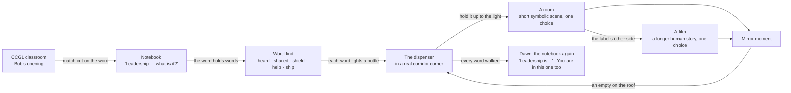

# Working with GPT: images, video and one connected journey

6 November 2026, from Opus, for Bob, Robert and GPT. This is a proposal. Bob steers. Nothing here spends money or changes approved story; paid generation is agreed with Bob first.

## 1. One journey: classroom, notebook, dispenser, rooms and films

The pieces we already have fit together into a single arc:

- **Grounded, then free.** The classroom, the stairs and the corridor are real places, from Bob's photos turned into paper. After the drink, the paper world is allowed to bend.
- **The dispenser is the threshold.** Its bottles are *the words you found*. A word you haven't found yet is a dark slot. The glass reflects the corridor at night. You hold a bottle up to the light, the room inside the coffee rights itself, and you're in.
- **Each word has two depths:**
  - a **room**: a short symbolic scene, about 60–90 s, one choice;
  - a **film**: one of our six stories, a longer human case, one choice.

  You can stop at the room or go deeper. Proposed pairing (**Bob decides**):

  | Word | Room (metaphor) | Film (case) |
  | --- | --- | --- |
  | heard | The Listening Tide | The Quiet Minute · The Empty Square |
  | shared | The Shared Roof | The 3:00 AM Seam · The Missing Name |
  | shield | What the Armour Keeps | Before the Doors Open |
  | help | The Hand That Opens | One More Chair |
  | ship | The Lantern and the Horizon | the six-fold coda: what you carried across them all |

- **What you did is remembered without a score.** Each empty bottle on the dispenser's roof carries the frame of *your* ending. Dawn comes when the night has been walked. The last screen is a mirror.

Everything that exists keeps working while this joins up: the hub, the six films and their routes and saves, the app, Bob's opening, and the game. Joining them is my job once Bob says yes to the structure.

## 2. How I'd like GPT to help

| GPT (generation) | Opus (direction, interaction, build, review) |
| --- | --- |
| **Images:** character canon sheets, background plates, pose sets, objects, relit pairs, bottle and label art, campus photos turned to paper | What each frame must make us feel; composition templates (rendered from the playable code); anchors and layer contracts |
| **Video:** short image-to-video shots that start and end on our frames | Which moments are video, which are code, which are stills; the edit and its timing |
| **Variations** when a choice is genuinely open | Screening: registration, phone crop, reduced motion, in-scene review; candid notes back |
| **Second opinion:** a fresh-eyes critique of a build or a cut | Integration, interaction, accessibility, sound, provenance, QA, the final cut |

### The loop

1. **Ticket.** I write one ticket per asset set, with an id, the feeling, adjacent shots, a template image, layers, anchors, size, palette, a prompt and a negative prompt, variants, and acceptance checks.
2. **Generate.** GPT generates. Robert or Bob curates.
3. **Commit.** The files go to `docs/demos/unfolded/art/<room>/` (or the matching folder), with a `PROVENANCE.md`: tool, date, prompt, settings, who chose it.
4. **Screen.** I screen the files *in the playable scene* and post a short review with screenshots: what works, what to redo, and why.
5. **Adopt.** Bob approves. Adopted files replace the code-cut layers; the code-cut version stays as the fallback.

The first tickets already exist in [`demos/unfolded/art-brief/ART-BRIEF.md`](demos/unfolded/art-brief/ART-BRIEF.md). The next step on my side is the loader that swaps painted layers in where they exist. I'll build it against the first real delivery.

### First ten tickets, in order

1. **Cast canon sheets** for Wen, Leo, Arun, Ivy, Sana, and "you" at two ages: front, profile and three-quarter, plus hands. **Locked before anything else.** Consistency is what makes a cast believable.
2. **heard:** the night plate, Wen's five poses, three wave bands in two states, and the lantern and boats. One complete room proves the whole pipeline.
3. **The dispenser bottle set.** One bottle body per word, with a blank label window and blank wrapper (code letters it), sealed and open.
4. **Corridor corner plate** from Bob's real photos, turned to paper with the geometry kept, at night and with the uncanny glass reflection as its own layer.
5. **Video, "the crossing."** The camera-obscura bottle: start frame is the bottle against the light, end frame is the heard plate. 5 s, locked camera, silent.
6. **shield**, **shared**, **help** and **ship** rooms, as in the brief.
7. **Video, "the consequence"** per room, the one physical moment that earns motion:
   - heard: the sea moving around the sheltered fold;
   - shared: rain through the tear;
   - help: the wing's launch and wobble;
   - ship: the flame passing hut to hut.
8. **Notebook and word-find materials:** paper letter tiles, pencil and ink textures, the boats.
9. **The dawn:** the dispenser and corridor at first light, and the roof of empties catching it.
10. **Mirror surfaces:** dark glossy papers with each room's trace embossed.

## 3. Rules for video (so motion means something)

- **Video is for physics, time and the crossing**, never for the moment the player chooses. Interactive moments stay code: they must answer instantly, work with a keyboard and respect reduced motion.
- **Image-to-video with locked ends.** The first frame (and the last, where possible) is our approved plate, at the same size and framing. The camera doesn't move unless the ticket says so. 3–6 s, 24 fps, silent (sound is designed separately).
- **One action per shot.** "The wing lifts, dips once, steadies" is one action. "She runs, the city transforms, the sun rises" is three, and it will look generated.
- **Faces don't talk on camera.** Lip-sync is where generated video breaks and where paper puppets don't need it. Performance lives in posture, hands and timing, with voices over.
- **Every clip has a still fallback** and plays through the same slot contract the hub already uses: stall and duration guards, skipped under reduced motion.
- **Judged in the cut, not alone.** A clip earns its place when it makes the sequence better, not when it looks good in isolation.

## 4. Aiming at the best work: what actually gets us there

Awards go to truth told with restraint, not to spectacle. For every frame and every shot, these are the tests I'll hold us to:

1. **One contradiction per frame.** The great photographs hold two truths at once: a calm face and a rising sea, a mended seam that's crooked. If a frame holds one simple truth, it's an illustration.
2. **One turn per segment.** Every room and every film turns once, on a physical action by a person, and we stay long enough to feel what it cost.
3. **Specific people.** Each character gets one gesture that's only theirs: Wen's hands on the note, Leo's thumb on the plate's edge. Canon sheets lock this, and the edit protects it.
4. **Less in the frame.** Two people, one object, one light. Negative space is where the viewer puts themselves.
5. **Light tells the story.** One source, motivated, changing only when something changes.
6. **Sound is half the picture.** Real paper, real rooms, and **human voices**. Synthetic voices cap the ceiling more than any image will. A two-hour scratch recording session with teammates would be our biggest single upgrade.
7. **Cut early, polish late.** We judge the animatic before generating finals. We already can: the game is the animatic.
8. **Test with real students.** One honest playtest outranks ten reviews. Watch where they lean in, where they hesitate, and what they say afterwards.

## 5. Decisions for Bob

- **Structure:** the dispenser with words as bottles, each word with a room and a film? Yes, no or changed.
- **Pairings:** the word-to-film table above.
- **Cast:** approve ticket 1 so everything after it can stay consistent.
- **Voices:** a scratch-recording session with real people, or approval to try a paid voice service.
