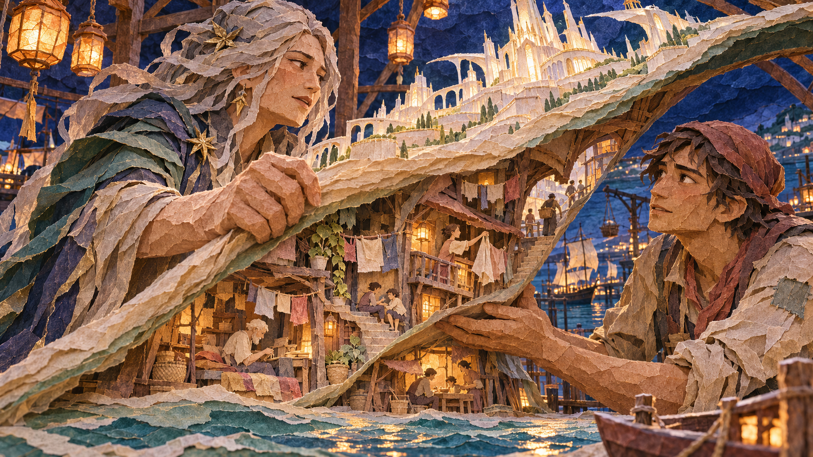
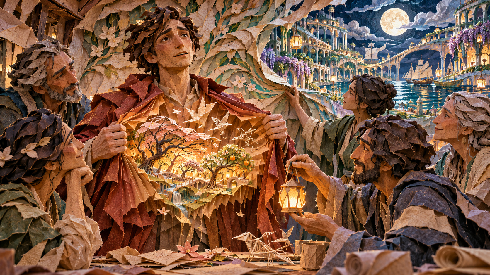
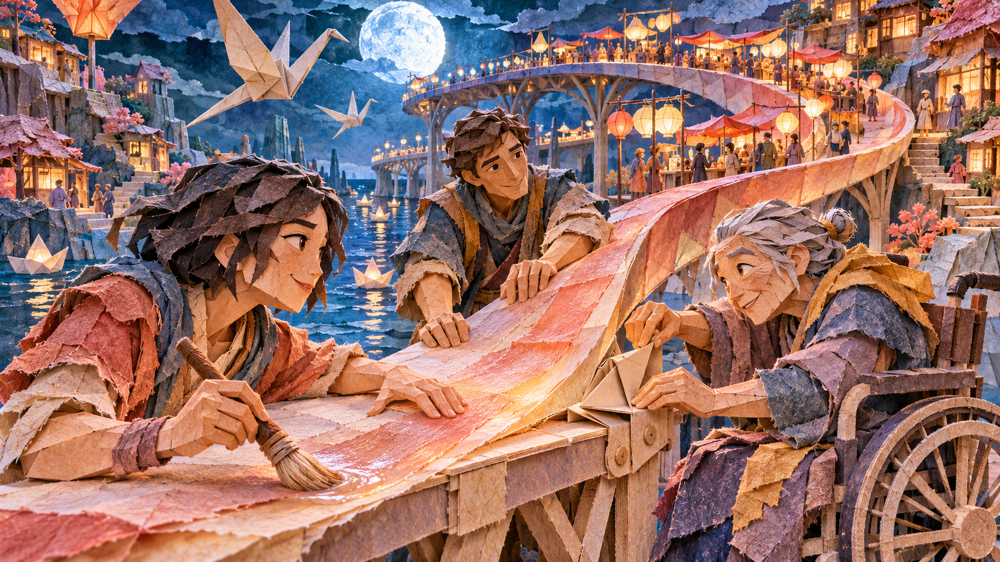
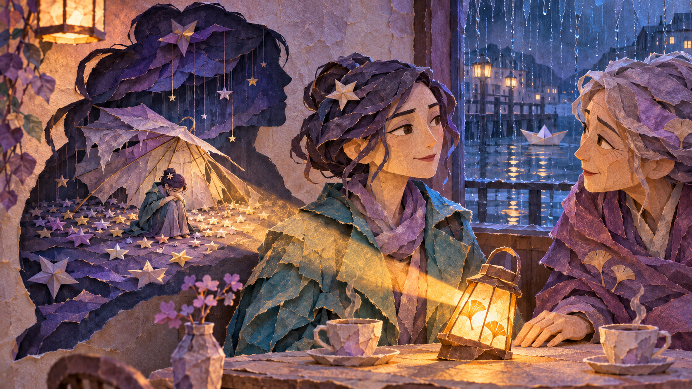
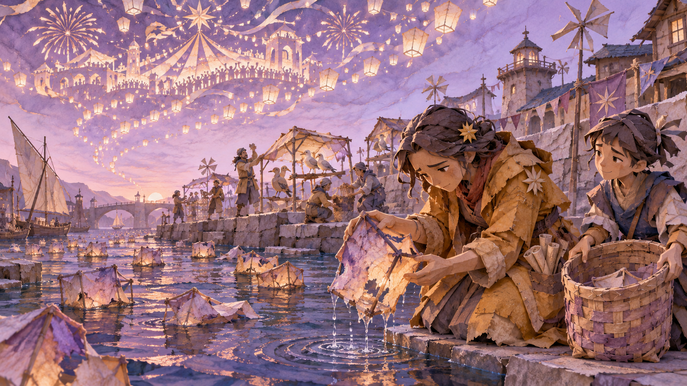
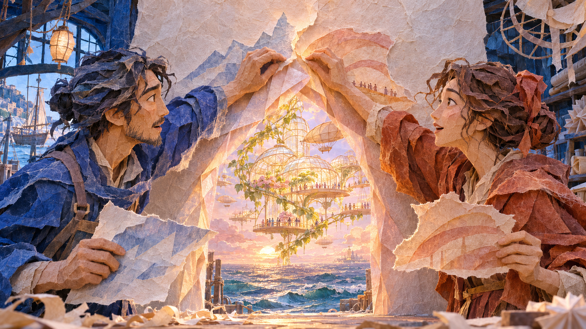

# Choices

[Back to the collection](README.md)

Seven scenes about perspective, responsibility and the consequences of action.

These are exploratory stills. Each intent describes the idea, not a validated audience interpretation.

## C01 · The Weight of One Small Turn

**Intent:** A leader sees the distant consequences of a seemingly small allocation decision.

**Develop it:** Both waterways should serve credible needs. The decision becomes dramatic when there is no decorative wrong answer.

[Original PNG](originals/choices/c01-the-weight-of-one-small-turn.png) · [Recorded prompt or available brief](prompts/c01.md)

## C02 · The Map Turns Around

**Intent:** Empathy changes the perspective from which a decision is made.

**Develop it:** Let the dockworker change the plan, not merely supply a moving revelation for the leader.

[Original PNG](originals/choices/c02-the-map-turns-around.png) · [Recorded prompt or available brief](prompts/c02.md)

## C03 · The Courage to Unfold

**Intent:** Honest vulnerability expands the room for everyone.

**Develop it:** Make disclosure voluntary, partial and reversible. The room can become safer without everyone having to reveal themselves.

[Original PNG](originals/choices/c03-the-courage-to-unfold.png) · [Recorded prompt or available brief](prompts/c03.md)

## C04 · The Bridge That Bends

**Intent:** A good solution changes shape to include people previously left out.

**Develop it:** Keep the wheelchair user a co-designer with expertise. Make the new route usable rather than symbolic only.

[Original PNG](originals/choices/c04-the-bridge-that-bends.png) · [Recorded prompt or available brief](prompts/c04.md)

## C05 · The Shadow at the Table

**Intent:** Leadership notices the feelings a composed face cannot say.

**Develop it:** Do not let the friend diagnose the shadow-room. Stage a small invitation and leave the response to its owner.

[Original PNG](originals/choices/c05-the-shadow-at-the-table.png) · [Recorded prompt or available brief](prompts/c05.md)

## C06 · What We Leave Floating

**Intent:** Responsibility includes the quiet aftermath of an exciting choice.

**Develop it:** Make the repair alter a future practice. One beautiful cleanup should not cancel the cost of the celebration.

[Original PNG](originals/choices/c06-what-we-leave-floating.png) · [Recorded prompt or available brief](prompts/c06.md)

## C07 · The Door They Made Together

**Intent:** Creative disagreement can build an option neither person could see alone.

**Develop it:** Preserve something each maker cared about. The third doorway should emerge from their work, not reward agreement by magic.

[Original PNG](originals/choices/c07-the-door-they-made-together.png) · [Recorded prompt or available brief](prompts/c07.md)
