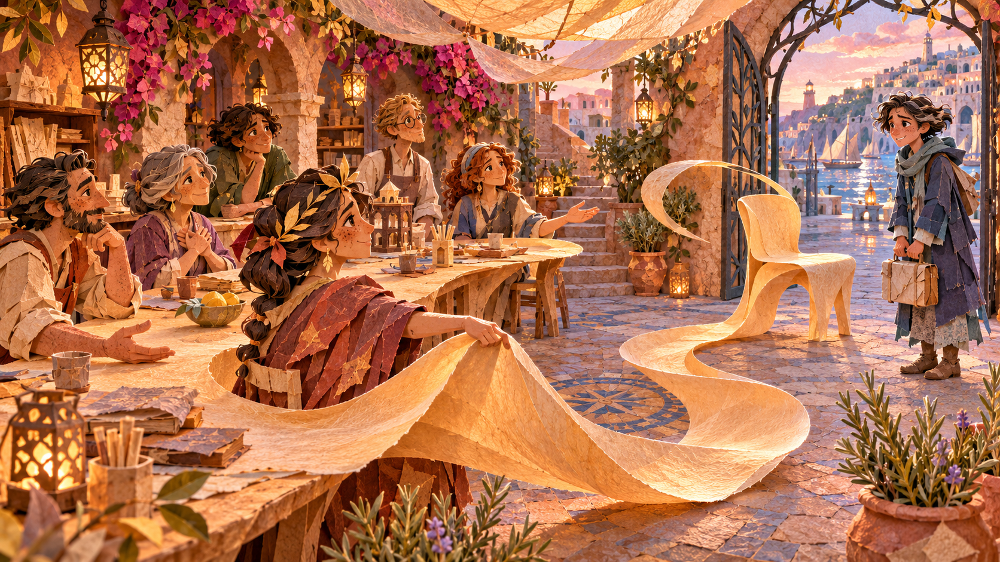
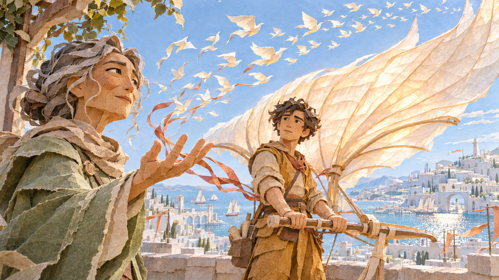

# Metaphors

[Back to the collection](README.md)

Seven intimate gestures whose meaning changes the surrounding paper world.

These are exploratory stills. Each intent describes the idea, not a validated audience interpretation.

## M01 · The Listening Tide · intimate harbor variation

**Intent:** Listening offers shelter without trying to flatten another person’s experience.

**Develop it:** Keep the waves unsettled while the listener stays present. Listening need not instantly calm or cure them.

[Original PNG](originals/metaphors/m01-the-listening-tide.png) · [Recorded prompt or available brief](prompts/m01.md)

## M02 · A Place Left Open

**Intent:** Belonging means making room that fits the person.

**Develop it:** Leave room for the newcomer to decline or change the invitation. Belonging is more than an empty chair.

[Original PNG](originals/metaphors/m02-a-place-left-open.png) · [Recorded prompt or available brief](prompts/m02.md)

## M03 · The Weight We Cannot See

**Intent:** The responsibilities people quietly carry need to be seen before they can be shared.

**Develop it:** What burden can the colleague actually share? Avoid making recognition alone solve an impossible workload.

[Original PNG](originals/metaphors/m03-the-weight-we-cannot-see.png) · [Recorded prompt or available brief](prompts/m03.md)

## M04 · The Menders of Dawn

**Intent:** Invisible maintenance makes everyone else’s work possible; recognition begins by noticing.

**Develop it:** Let the mender accept rest or practical help, rather than rewarding endless invisible work with gratitude alone.

[Original PNG](originals/metaphors/m04-the-menders-of-dawn.png) · [Recorded prompt or available brief](prompts/m04.md)

## M05 · The Country Between Us

**Intent:** De-escalation can begin with one unclenched hand.

**Develop it:** Give both sides a reason to remain cautious. One open hand can begin repair without erasing the disagreement.

[Original PNG](originals/metaphors/m05-the-country-between-us.png) · [Recorded prompt or available brief](prompts/m05.md)

## M06 · The Hand That Opens

**Intent:** Trust gives someone room to act while remaining present.

**Develop it:** Show what support remains after control is released. Trust should not turn into abandonment.

[Original PNG](originals/metaphors/m06-the-hand-that-opens.png) · [Recorded prompt or available brief](prompts/m06.md)

## M07 · What the Armor Was Keeping Safe

**Intent:** Defensiveness can be protecting something vulnerable, not concealing bad intent.

**Develop it:** The person inside opens the fold. A sympathetic observer does not earn the right to pull the armor away.

[Original PNG](originals/metaphors/m07-what-the-armor-was-keeping-safe.png) · [Recorded prompt or available brief](prompts/m07.md)
