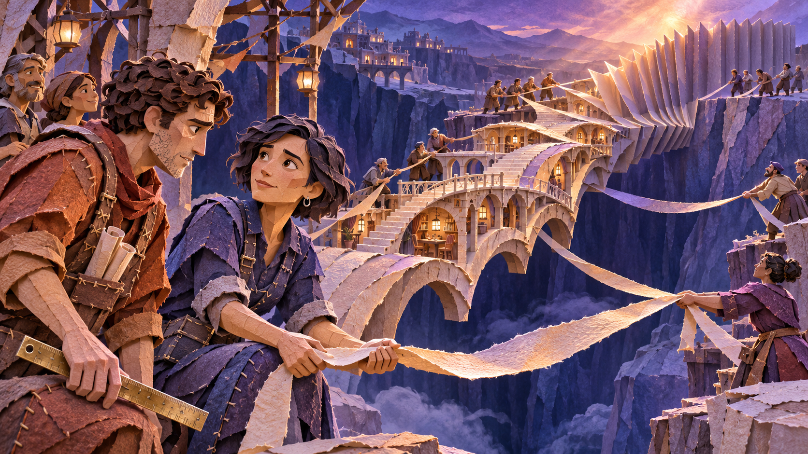
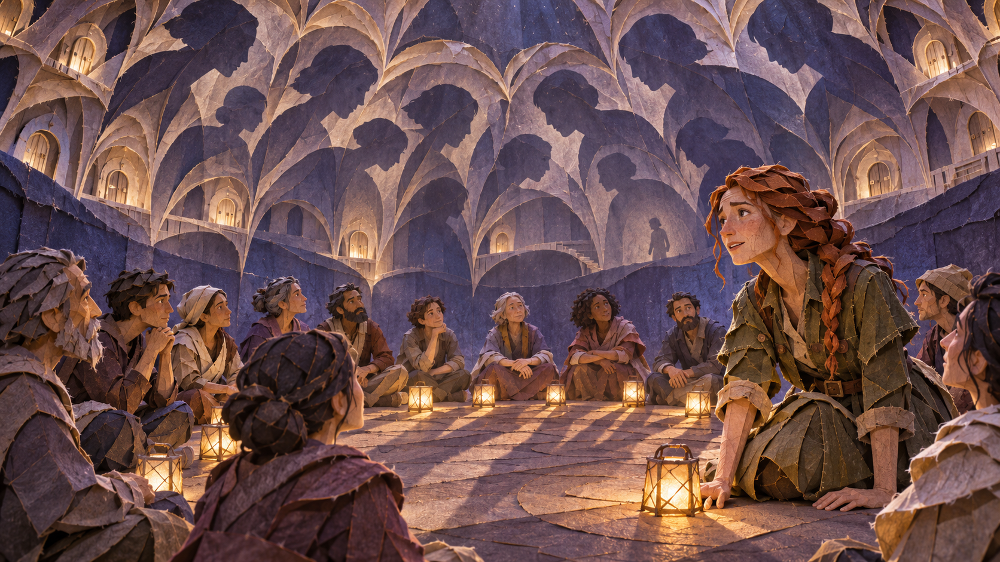
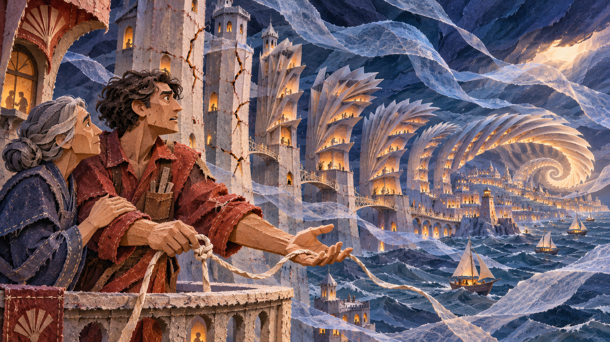
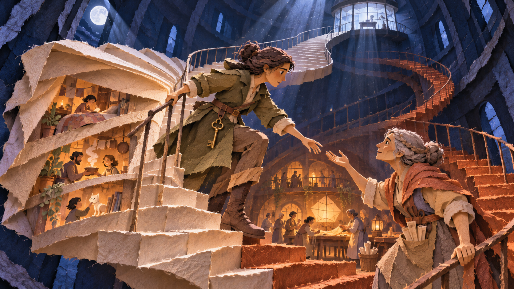
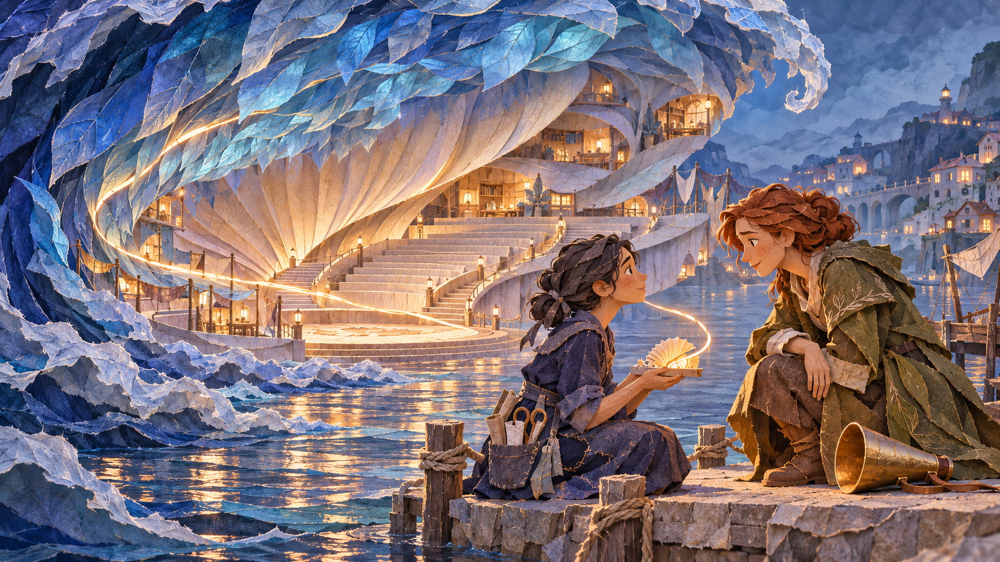

# Wonders

[Back to the collection](README.md)

Seven architectural transformations. Let the human decision remain visible at the scale of the city.

These are exploratory stills. Each intent describes the idea, not a validated audience interpretation.

## W01 · The Bridge That Answers Back

**Intent:** An unfinished bridge becomes habitable architecture when a master builder puts down his ruler and many hands shape the connecting ribbon.

**Develop it:** Show the builder learning from the distributed shape. Do not imply shared authorship means structure has no constraints.

[Original PNG](originals/wonders/w01-the-bridge-that-answers-back.png) · [Recorded prompt or available brief](prompts/w01.md)

## W02 · The Parliament of Shadows

**Intent:** A leader joins the circle at floor level. Individual shadows combine into a protective vault: shared attention becomes shelter.

**Develop it:** Keep one dissenting silhouette legible inside the vault. Shared attention need not mean unanimous agreement.

[Original PNG](originals/wonders/w02-the-parliament-of-shadows.png) · [Recorded prompt or available brief](prompts/w02.md)

## W03 · The City That Learned to Bend

**Intent:** The builder releases the controlling cord. Inhabited towers fan into a spiral that adapts to the storm rather than resisting until it breaks.

**Develop it:** Make the release frightening and its benefit observable. Flexibility still needs limits, anchors and maintenance.

[Original PNG](originals/wonders/w03-the-city-that-learned-to-bend.png) · [Recorded prompt or available brief](prompts/w03.md)

## W04 · The Staircase into Someone Else

**Intent:** A leader turns away from an isolated command room and descends toward another person. The pristine stair unfolds to reveal hidden lives.

**Develop it:** Give the craftswoman the option to meet halfway. Empathy should not stage one person as an exhibit to be visited.

[Original PNG](originals/wonders/w04-the-staircase-into-someone-else.png) · [Recorded prompt or available brief](prompts/w04.md)

## W05 · The House in the Tear

**Intent:** A woman stops concealing a tear. Its rough edges become an inhabitable neighborhood, making an acknowledged mistake a place for repair.

**Develop it:** Keep a visible repair seam and a real cost. Acknowledging error opens work; it does not make the error disappear.

[Original PNG](originals/wonders/w05-the-house-in-the-tear.png) · [Recorded prompt or available brief](prompts/w05.md)

## W06 · The Listening Tide · civic amphitheater variation

**Intent:** A leader kneels to listen to a shy craftswoman. Her small model transforms an enormous suspended paper wave into a public amphitheater.

**Develop it:** Can the small model remain a proposal that others reshape? One quiet voice should gain influence without becoming the new sole authority.

[Original PNG](originals/wonders/w06-the-listening-tide.png) · [Recorded prompt or available brief](prompts/w06.md)

## W07 · The Lantern That Became a Horizon

**Intent:** The keeper shares his central flame. One lighthouse unfolds into a horizon of small connected shelters, distributing direction and responsibility.

**Develop it:** Show who maintains each new light. Distributed responsibility needs resources, consent and a way to ask for help.

[Original PNG](originals/wonders/w07-the-lantern-that-became-a-horizon.png) · [Recorded prompt or available brief](prompts/w07.md)
