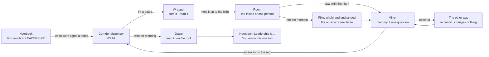

# One night: the journey

6 November 2026, Opus. This is the structure for the whole of *Leadership, unfolded*. The HEARD route is built and playable from end to end; everything else here is marked as built or proposed. The pairings and story changes are proposals until Bob says otherwise.

## Status, 6 November (evening)

Bob approved the direction. What changed since the first draft below:

- **All built and playable:** every word has its room and its film, and the whole night runs end to end.
- **The corridor is the real After Hours dispenser** (`hub/` in journey mode), not a code-cut stand-in.
  - Bottles light as their words are found.
  - The tag carries the word, *Drink when…* and the ingredients.
  - The empty lands on the roof and the clock moves.
  - The hub's dawn finale is the morning.
- **Pairings as proposed**, with one revision:
  - **ship** keeps *The Lantern and the Horizon*, recast with **Inez** from *One More Chair*. The boat out at sea is the one more at closing.
  - It's cheaper than a new room and it holds the same dilemma (one strong light, or many small ones). *The Last Boat* is no longer needed.
- **The three film line changes are applied** (see `INTERACTION-AUDIT.md`).
- **Not yet:** Bob's classroom opening joined to the notebook, and painted room art.

## In one breath

A notebook says *Leadership — what is it?* You find words inside the word, and each one lights a bottle in a dispenser in a corridor at night.

- **The bottle.** You read its wrapper and hold it up to the light. Inside the glass, upside down, is a room. It rights itself and you're in.
- **The room.** It's the inside of one person you're about to meet: what they carry into a scene they can't say it in. You make one choice there.
- **The film.** Through the label's other side lies the morning: a film where that person sits at a real table with a real dilemma, and you make another choice.
- **The mirror.** It remembers both choices together and asks one question.
- **The roof.** An empty goes up on the dispenser roof with a frame of how it ended, and the clock moves towards morning.
- **Dawn.** The light reaches the roof first, and the notebook opens again: *Leadership is…*

## Why this shape

- **The films keep the dilemmas; the rooms carry the people.** Every film already has a concrete table, a deadline and a door at closing time. What a film can only hint at is what one person carries in. Each room is that, so the film's quietest line becomes the moment you've been waiting for.
- **Grounded, then free.** The notebook and corridor are real places. Their paper art comes from Bob's photos of the CCGL rooms and corridor; until those arrive, the code-cut versions stand in. Once you drink, the paper is allowed to bend.
- **Memory without a score.**
  - The mirror line combines the two choices.
  - The empty holds a frame of the ending.
  - The notebook writes a pencil note by each word.
  - Nothing is ranked, and nothing leaves the screen.

## The six words

Each room is the inside of one person *in* its film. That's what makes the films one world rather than videos attached to rooms.

| Word | Bottle | Room (the inside) | Film (the outside) | Why this pairing | Status |
| --- | --- | --- | --- | --- | --- |
| **heard** | Standup Seltzer | *The Listening Tide*: Ellis at the harbour, where Theo's route ends and Ellis's never reaches | *The Quiet Minute* | The film's quietest person: "Another route stays folded." | **Built and playable end to end** |
| **lead** | Slide Deck Bitters | *The Map Turns Around*: you at the front with a beautiful map; it turns to show the hand that drew it (Asha) | *The Missing Name* | Leading includes saying whose map it is | Room proposed. The bottle opens straight into the film (built). |
| **shared** | 3:00 AM Cold Brew | *The Shared Roof*: a canopy, a tear and who holds the tool. Recast Arun as **Julian**. | *The 3:00 AM Seam* | Two good things want the same hour; whose rib moves | Room built (as Arun). Film embedded. Recast proposed. |
| **shield** | Ship-It Ginger Ale | *What the Armour Keeps*: Recast Leo as **Dev**, whose armour keeps a paper city | *Before the Doors Open* | The rehearsal reel *is* armour; only Dev can open it | Room built (as Leo). Film embedded. Recast proposed. |
| **help** | Dead Pixel Tonic | *The Hand That Opens*: the wing and the ribbons | *The Empty Square* | Help that doesn't take the controls | Room built (Ivy). **Hold the recast until lived-experience review.** The wing metaphor must not frame Jo's access as something you grant. |
| **ship** | Scope Creep Fizz | *The Last Boat*: closing time at a small dock, one boat with one seat left, and Sam with a torn bag | *One More Chair* | A ship is what has room, or doesn't, for one more | Room proposed. For now the bottle opens *The Lantern and the Horizon* (built). |

**Two crossovers worth keeping:**
- The *Ship-It* bottle holds **shield**: under the urge to ship is the wish to look perfect.
- The *Scope Creep* bottle holds **ship**: the vessel with room for one more.

The labels never say this; the player finds it. If it confuses playtesters, swap the two words (and the two rooms) and nothing else changes.

**The lantern room becomes the dawn.** *The Lantern and the Horizon* (one flame shared hut to hut) is the image for the end of the night: the corridor wakes, lights come on along the corridor one by one, and the empties catch them. **Proposed.** The current dawn is simpler: the light comes up, then the view leans in on the roof.

## The bottles

The wrappers are real-looking manufactured drinks with playful marketing, and the small print knows a little too much. They never name an outcome. Brand names and the first ingredients are the hub's approved copy. The *Drink when…* lines and the unexpected ingredients are new proposals.

| Word | Tagline | Drink when… | Unexpected ingredients | Small print |
| --- | --- | --- | --- | --- |
| heard | For loud rooms. | you've said it in your head three times. | the end of someone else's sentence; a pause (2%); courage (trace) | Best served without interrupting. Contains one folded alternative. |
| lead | A few drops transform any opening. | everyone's looking at you to start. | nerve; Made by: ______ | Not the only word in the bottle. Credits may settle at the bottom. |
| shared | Steeped since midnight. | two good things want the same hour. | someone else's deadline; a pinch of courage | Store away from direct light. Best shared before it sets. |
| shield | Brewed to open on time. | you'd rather it looked perfect. | one honest sentence | Seal may show signs of tampering. That's the point. |
| help | Clear, with a bitter edge. | you're about to do it for them. | an open hand; patience (to taste) | Shake gently. Let them open it. |
| ship | Contents under pressure. | it's almost closing and someone's at the door. | room | Ask about tomorrow's batch. |

**What makes them fun to discover:**
- you turn the bottle to read the back;
- the found word sits in a stamped window on the front, in your pencil;
- the last panel says *Hold up to the light*;
- dark slots stay dark until you find their word.

## Transitions (what each threshold does)

| From → to | Built | What happens |
| --- | --- | --- |
| Notebook → corridor | yes | *Close the notebook.* The corridor at 03:14; the found words are lit bottles, the rest dark silhouettes. |
| Corridor → bottle | yes | Lift a bottle. Turn it with the arrow keys, by dragging, or with the buttons. |
| Bottle → room | yes | *Hold it up to the light.* The bottle lifts; inside the glass the room appears upside down, rights itself and opens out (a camera obscura). Reduced motion cuts straight to the room. |
| Room → film | yes | One last choice at the end of every room: *Stay with the night*, or go into the morning. HEARD's labels follow the branch: *Follow the boat* or *Carry your promise*. A paper slate remembers what was said, then the film plays whole, inside the frame. Completion comes from the film's existing message. |
| Film / room → mirror | yes | Dark glossy paper; a memory line that combines both choices; the question; *See the other way* (optional). |
| Mirror → corridor | yes | An empty goes up on the roof with a frame of the ending. The clock moves on (03:14 → 06:02, the hub's night). |
| Corridor → dawn | yes | *Wait for morning*, at any point after one walk. The light comes up, then the view leans in on the roof, where every empty shows how it ended. |
| Dawn → notebook | yes | *Leadership is…*: the found words written around it, your own word if you want, then *You are in this one too.* |
| Classroom → notebook | proposal | Bob's match-cut opening (on `concept/leadership-opening-20261105`) leads straight into the notebook. |

## The ending: what it should leave you with

**No definition.** The last notebook page puts *your* words around *Leadership*, and the dawn shows the roof of empties, each a different picture of what you did. Then the line *You are in this one too.*

**The thought I want people to walk out with:** leadership wasn't one of those choices. It was noticing what each one cost, and who paid.

## What's built and tested, and what isn't

- **Built and played in Chromium:**
  - **The route:** word find (six words), corridor, bottle, crossing, HEARD (both branches, the optional look), film embed with completion, the mirror with combined memory, the other way, the empties, dawn and the ending.
  - **Embedded films:** LEAD opens *The Missing Name* directly.
  - **Other rooms:** all five open from their bottles and offer their films.
  - **Access:** keyboard only; 390×844 with touch and reduced motion; no console errors.
- **Not yet checked:**
  - a human playtest;
  - a screen reader;
  - listening by ear (voices and sound were rendered and measured, not heard);
  - the *Seam* film's completion message inside this frame (it uses an older adapter, so *Back into the night* is always available).
- **Proposals:**
  - the LEAD and SHIP rooms;
  - the recasts;
  - the lantern-room dawn;
  - every film line change in `INTERACTION-AUDIT.md`;
  - the classroom join.
