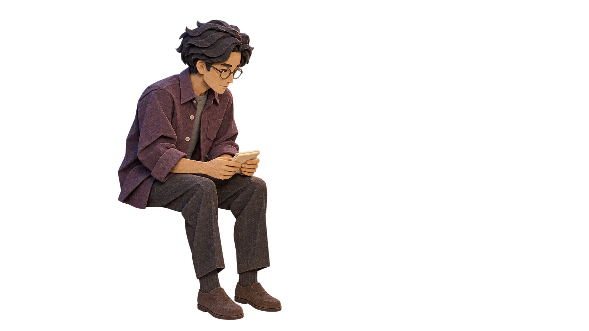

# H-02 Ellis brace: candidate B

6 November 2026. **Exploratory paper-style image candidate only. The wider art direction is being reconsidered. This does not lock the project to paper, and is not registered production art or canon approval.**

## What this adds

One new generated, genuinely transparent Ellis cutout: seated, facing right, holding a compact folded packet. It follows the latest corrections in [CAST.md §6](https://github.com/bobshenruililin/asterwind/blob/42b5d965e005a2a49eec49851db8463850b179fa/docs/demos/unfolded/CAST.md), with the film master controlling identity. This is a restrained performance/finish proof before a pose batch. The original image is unchanged.

No runtime, manifest, story, save, deployment or existing asset is changed. The default code-cut art remains in place. There is deliberately no candidate manifest: partial figure sets currently fall back to their first image, so a brace-only set would show brace during unrelated beats.

## Production facts and verification

- Generated with the built-in image-generation tool on 6 November 2026. No separately charged external service or real-person source was used.
- Exact prompt: [ELLIS-BRACE-PROMPT.txt](ELLIS-BRACE-PROMPT.txt).
- Source: PNG, **1672×941**, RGBA, **554,930 bytes**.
- Requested size was 3200×1800. The returned source does **not** meet that native-resolution requirement. No upscaling is presented as native detail.
- SHA-256: `6662273974d8fb7e6b792c83214a154de4f4ee12d96c78fcaf206ba9cbe78d8a`.
- Alpha is real: 86.222% of pixels are alpha 0. Most solid figure pixels have alpha 252–253, and faint alpha flecks exist outside the silhouette. Clean-alpha inspection is still needed before runtime use.
- Thresholded figure bounds at alpha ≥128: x **335–798**, y **56–908**, with exclusive box **(335,56,799,909)**.
- The image was visually inspected against the canonical master, candidate A board and pose sheet. The cut-paper detail, round glasses, blue-black hair and adult seated silhouette work as a direction. Hands grip a closed packet rather than an open sheet. The precise repeated thumb-press gesture and plum colour still deserve scene review.
- **Registration fails as delivered:** the figure is about 90.6% of canvas height, and is not placed at the requested hip anchor. This is a source cutout for registration, not a drop-in full-stage layer.
- No composed-scene, 200px, phone, branch, animation, screen-reader or browser QA is claimed for this candidate.

## Reference hierarchy

1. [The Quiet Minute master](https://github.com/bobshenruililin/asterwind/blob/42b5d965e005a2a49eec49851db8463850b179fa/anthology/episodes/standup/assets/reference-v1/01-quiet-minute-master.webp), Ellis on the right: identity, hair, glasses, overshirt, paper construction.
2. [Ellis candidate A](https://github.com/bobshenruililin/asterwind/blob/5b01bbf71e872118d17e9a54f58a208603afe1b9/cast/heard-ren-ellis-candidates-a/Asterwind-Heard-Ellis-Cast-Candidate-A.png), body construction, subject to the latest correction notes.
3. [heard-v2-poses.jpg](https://github.com/bobshenruililin/asterwind/blob/42b5d965e005a2a49eec49851db8463850b179fa/docs/demos/unfolded/art-brief/templates/heard-v2-poses.jpg), placement and pose, not final visual finish.
4. [Current CAST.md](https://github.com/bobshenruililin/asterwind/blob/42b5d965e005a2a49eec49851db8463850b179fa/docs/demos/unfolded/CAST.md) overrides the stale names, wardrobes and ages in the older ART-BRIEF.

## Smallest question for Opus before registration

Keep hip **(1220,1192)** on the 3200×1800 delivery canvas. Which figure height should control?

- CAST asks for about **860px** seated height.
- The current code puppet uses **s=1.75** and roughly 348 internal pixels head-to-foot, so its full-stage height is roughly **1218px** at 3200. The pose-sheet silhouette agrees with this larger construction.

Please confirm whether the current on-screen silhouette or 860px is intended. The candidate can then be registered and compared, without pretending both measurements agree.

## Integration checks before adoption

- Provide true per-pose fallback. A missing painted pose should use its corresponding code puppet, not the first painted pose.
- Decide whether the held packet belongs to the figure or an object layer. Replacing the code puppet currently removes its dynamic `h-note` child.
- Keep the painted wall separate from the sky/sea plate and preserve `h-back` between them, so the rising sea still carries Ellis's worry.
- Inspect alpha over dark indigo and light cream, then actual tabletop size and thumbnail size.
- Test both branches and all relevant pose changes, in 1280×720 and 390×844, plus reduced motion.
- Preserve source PNG and provenance; adopt only an explicitly reviewed derivative. Do not silently scale up and call it 3200-native.

See [VISUAL-AUDIT.md](VISUAL-AUDIT.md) for the wider art priorities and opening prompts.
