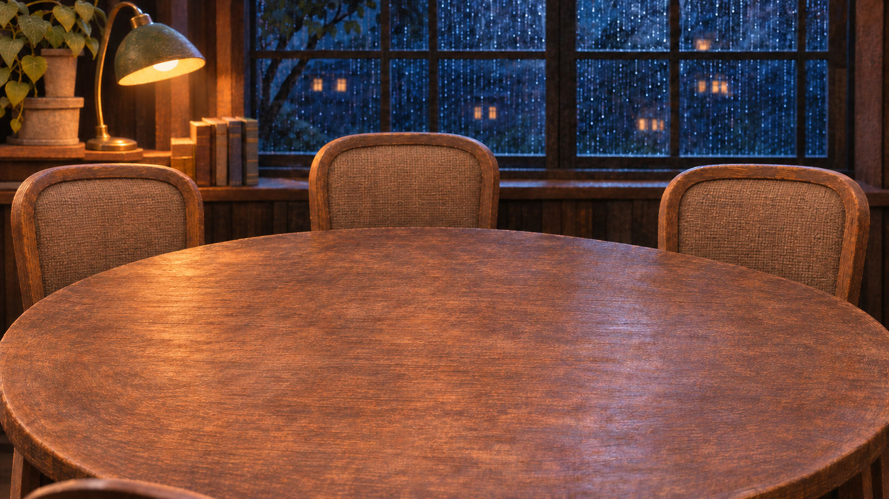

# The Quiet Minute: empty-set pilot component

7 November 2026. **A candidate backing plate for Opus's performance pilot, not an adopted style or a complete animation kit.**

## What is delivered

- `01-empty-set-v2.png`: **1672 × 941, RGB PNG**, matching the source canvas.
- The four people, platter/model, route papers, slips tray, slips, pencil and speaking token have been removed.
- The lamp, plant, books, rain windows, wooden table and seating remain. A second take restores the small foreground chair rail omitted by the first.
- Exact prompts and input roles are in [PROMPTS.md](PROMPTS.md). File hashes, source attribution and test boundaries are in [PROVENANCE.json](PROVENANCE.json).

This answers image 1 of [the current pilot brief](https://github.com/bobshenruililin/asterwind/blob/1a4eaa3b6469875a470c779cdaa95d1af34284eb/docs/SCENARIOS-2026-11-07.md). The exact [sculpted-miniature source image](https://github.com/bobshenruililin/asterwind/blob/d10d9eb955678ce09ceaf9367c7e380f15674b69/docs/production/quiet-minute-style-auditions/02-quiet-minute-sculpted-miniature.png) remains on its original audition branch.

## Review

**Passed:** the PNG decodes, matches the source dimensions, has the recorded hash, and has been visually inspected at its native composition. No person, model, tray, route paper or token remains. The fourth seat is present.

**Important limit:** this is reference-guided generation, not pixel-registered inpainting. Previously hidden wood and chair surfaces are reconstructed, and fine grain, rain and small boundaries have changed. Do not infer exact mask alignment or a seamless animated crossfade. Opus should check registration with the new character and prop layers before using it in the pilot.

**Not yet tested:** character identity across expressions, transparent edges, lip sync, hands against props, runtime hitboxes, phone-size and portrait rendering, rendered scene performance, or the first-time-player comparison. A local browser inspection was attempted but could not launch; no browser result is claimed. The backing plate alone cannot demonstrate a more moving scene.

No existing art was overwritten. No story, runtime, save format, default style, main branch or deployment was changed.

## Next useful check

Use this as the backing plate for one short performance proof: Nia tries to speak, Theo interrupts, then Nia firmly finishes the fact. Follow the current script at the same base commit, not the older audition's example lines. Check the same face at 390 px before expanding to the complete cast.

The remaining requested kit is still open: Theo, Nia and Ellis with four expressions × two mouths; Ren's back-view layer; and the five prop layers. The stage side-by-side and Bob-plus-two-friends clarity/emotion review remain the go/no-go for any wider conversion.

[Handoff to Opus](OPUS-FOLLOWUP.md)
