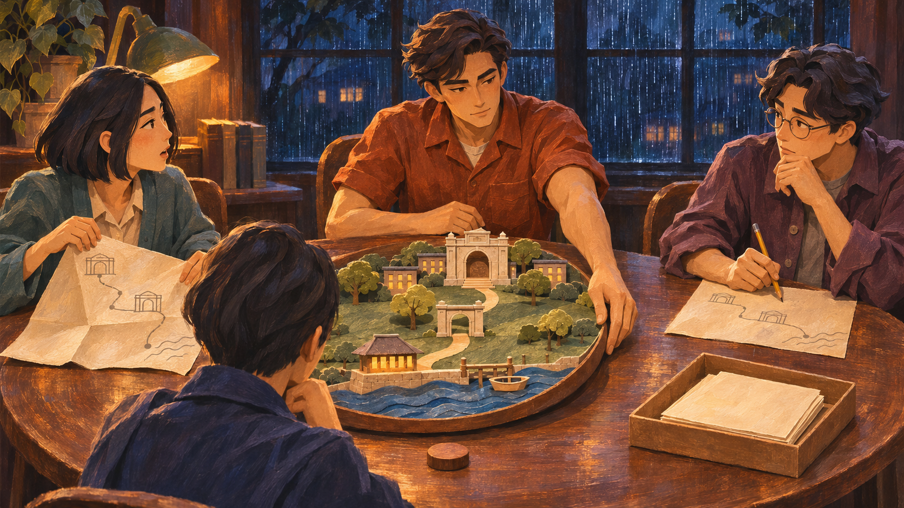
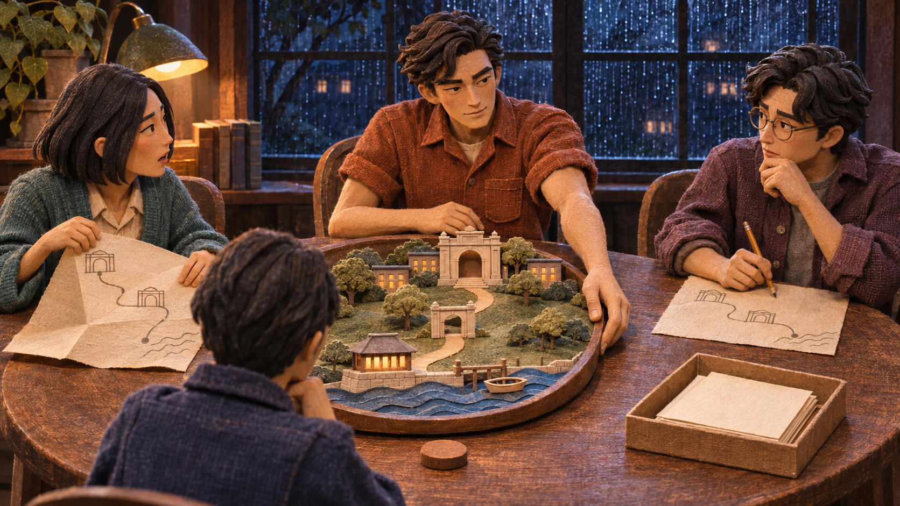

# Quiet Minute: two visual direction auditions

6 November 2026. **Discussion studies, not adopted game assets.**

Both images stage the same moment from *The Quiet Minute*: Nia has a concern, Theo still occupies the model rim, Ellis holds an alternative, and Ren can either turn the table or pass the slips. The cast, room, two objects, camera idea and amber/indigo lighting are held constant so the medium can be judged fairly.

## A. Painterly animated film

**What it gains:** softer painted skin, expressive eyes, brush-shaped light, atmospheric depth, and fabric that feels less folded. The small route model remains a physical object inside a painted human world.

**What this particular take has not solved:** the faces still inherit quite angular shapes from the source. It is an appealing bridge away from paper theatre, not yet a complete character-design reinvention. It does not demonstrate repeatable facial animation.

## B. Sculpted miniature drama

**What it gains:** dimensional noses, cheeks and eyelids, matte sculpted skin, woven costume fabric, and the feeling of an actually lit miniature set. It retains the handmade identity while moving beyond flat paper faces.

**What this particular take has not solved:** every surface is still baked into one raster. The sculpted look is not an actual rig or 3D asset. Texture can crawl, faces can drift and occlusions can change in separately generated frames.

## Recommendation

**B is the stronger next experiment.** It makes the biggest improvement to facial volume without asking Asterwind to abandon its handmade objects, practical lights and theatre scale. A remains a valuable alternative if the goal is a more fluid, painted feature-film world.

That is a recommendation for a **small performance test**, not approval to regenerate the whole game. Neither beauty nor apparent depth establishes a workable animation pipeline.

## What was kept

- Ren: indigo coat, short dark ear-length hair, back view only; face and gender unresolved.
- Nia: left, teal cardigan, black bob, unfolded route.
- Theo: rear centre, rust-orange short-sleeved shirt, hand controlling the model rim.
- Ellis: right, violet-plum overshirt, round glasses, blue-black wavy hair, pencil and route.
- One warm desk lamp, cool rainy windows, rotating route model, separate slips tray and speaking token.
- The meaningful choice remains **Turn the table / Pass the slips**. Neither branch is shown as the universally correct answer.

## Limits and next gate

- **Two independent still images.** No video, lip-sync, temporal consistency or rig was produced or tested.
- **1672 × 941 RGB PNGs.** They are not 3200 × 1800 production layers and have no alpha.
- Composition is matched by reference, **not pixel registered**. Small face, prop and camera differences remain.
- They have been visually reviewed at native image size. They have **not** been screened in the playable phone crop, hitbox layout or reduced-motion flow.
- They do not replace the current master, canonical cast sheet, runtime manifests or game defaults.
- Generated with the built-in image tool. It did not expose a model identifier; no claim is made that these came from a particular numbered model.
- No external video generation or paid provider workflow was started.

Read [PERFORMANCE-TEST.md](PERFORMANCE-TEST.md) before deciding on a whole-game conversion. Exact generation prompts are in [PROMPTS.md](PROMPTS.md); source attribution and file hashes are in [PROVENANCE.json](PROVENANCE.json).
